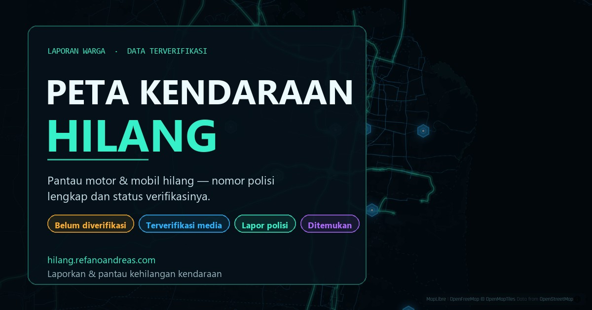
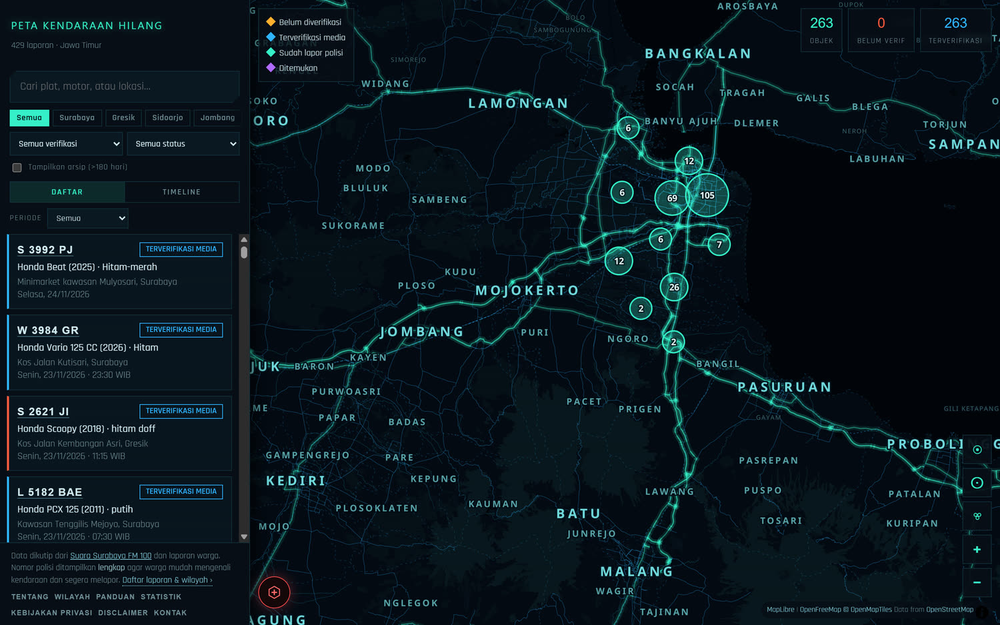
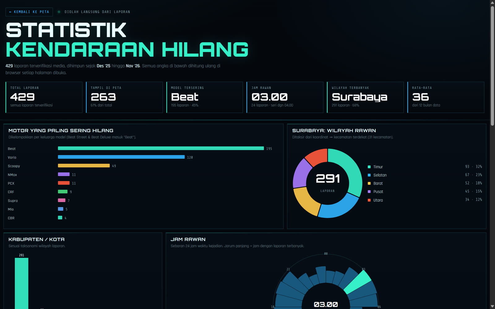
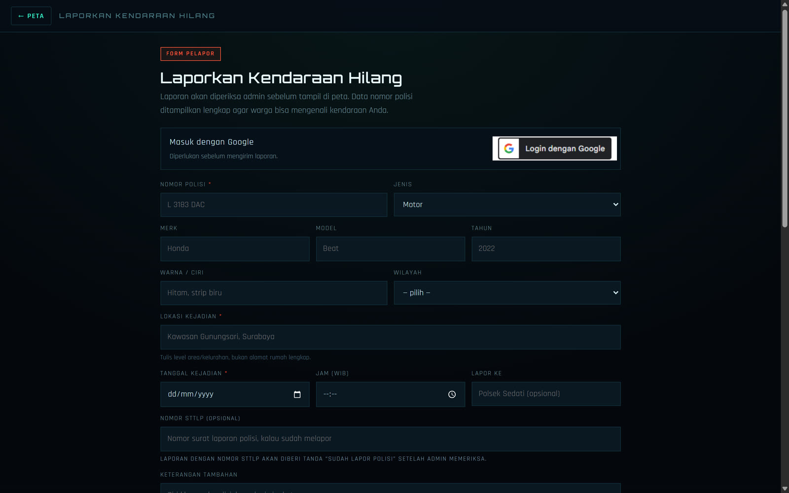

# Peta Kendaraan Hilang

[](https://hilang.refanoandreas.com)
[](#instalasi)
[](#tech-stack)
[](#tech-stack)
[](LICENSE)

Situs peta interaktif laporan kehilangan kendaraan bermotor di Jawa Timur — peta vektor gelap
full-screen, panel laporan yang bisa difilter, timeline, statistik, dan alur warga ikut melapor.
Dibangun sebagai **plugin WordPress mandiri** (tidak bergantung pada theme tertentu).

**Situs live:** <https://hilang.refanoandreas.com> — produksi, dipakai publik setiap hari (bukan demo).



Sumber data: pemberitaan media (mis. Suara Surabaya FM 100) dan laporan warga, dengan tautan
sumber di setiap laporan. Data lengkap hanya untuk pihak kepolisian; situs publik menampilkan
nomor polisi sesuai praktik pemberitaan agar warga bisa mengenali dan melapor.

---

## Tangkapan layar

**Peta interaktif** — marker heksagon ter-klaster, panel laporan dengan filter, timeline:

| Peta | Statistik `/analitik/` |
|---|---|
|  |  |

**Form laporan warga** (`/lapor/`) — wajib masuk dengan Google, isian terstruktur, masuk antrean moderasi:



---

## Sorotan teknis

- **±19.500 baris** PHP/JS/CSS (di luar pustaka vendor), tanpa framework — 36 modul `inc/` + 12 template.
- **Peta vektor MapLibre GL** dengan style kustom gelap; marker digambar sebagai layer vektor
  (bukan DOM element) → clustering native, LCP 5,1 s → 1,6 s, skor performa Lighthouse 49 → 66.
- **Importer berita**: tempel URL artikel → parser ekstrak plat, model, tahun, warna, lokasi,
  polsek → draft + koordinat otomatis (Nominatim). Satu artikel bisa jadi beberapa draft.
- **Alur laporan warga** dengan verifikasi Google Sign-In (`id_token` divalidasi di server),
  upload foto, dan panel moderasi.
- **SEO serius**: 31 halaman kecamatan long-tail, hub tautan internal, JSON-LD, sitemap, PWA.
- Ketergantungan eksternal untuk peta: tile OpenFreeMap — **tanpa API key, tanpa billing**.

## Fitur

**Peta & antarmuka**
- Peta vektor gelap penuh (MapLibre GL + style kustom "Ingress dark")
- Marker heksagon berdenyut: belum lapor polisi / sudah lapor / ditemukan
- Label nomor polisi muncul di bawah marker saat zoom ≥ 13,2
- Panel laporan: pencarian, filter jenis/wilayah/status, saklar clustering (tersimpan di localStorage)
- Timeline kronologis per tanggal, kartu detail, halaman laporan bernuansa gelap
- Arsip semua laporan dengan pencarian & paginasi, halaman cek status
- Tampilan mobile: deretan tombol dirapikan, panel bisa digeser

**Data & admin**
- CPT `kendaraan` + 3 taxonomy + meta terstruktur (lihat [Model data](#model-data))
- Importer dari URL artikel berita (parser + geocoding Nominatim, cache, fallback query)
- Impor massal, edit cepat berpeta, cari jalan, pencarian lintas plat/meta
- Ekstraksi AI opsional (JSON mode) sebagai jalur cadangan parser, dengan saklar on/off
- Impor dari postingan Instagram (embed → ekstraksi → moderasi), saklar izin default mati
- Notifikasi Telegram untuk laporan baru (opsional, token disimpan di opsi WordPress)
- Cek ulang: setelah ~30 hari, tanya pelapor "masih hilang?"

**Konten, SEO & keamanan**
- Halaman statistik `/analitik/` full-frame: 10 panel infografis (D3 + anime.js + GSAP, self-host)
- Hub wilayah `/wilayah/`, 31 halaman kecamatan long-tail, 5 halaman pilar `/panduan/…`
- Penyelarasan Pedoman Pemberitaan Media Siber (Dewan Pers)
- JSON-LD, sitemap, meta OG, verifikasi Search Console, `robots.txt` fail-closed di importer
- Pengerasan: tutup enumerasi user, XML-RPC, dan sitemap penulis
- PWA (manifest + service worker), GA4 opsional

## Tech stack

PHP 8.x + WordPress (CPT, REST API, template loader), MapLibre GL JS, vanilla JS/CSS,
D3, anime.js, GSAP (self-host di `assets/vendor/`), Nominatim/Photon untuk geocoding.
Tanpa build step — aset dikirim apa adanya, versi di-*bump* lewat konstanta `KH_CORE_VERSION`
supaya cache/CDN ikut berubah.

## Struktur

```
kendaraan-hilang-core/            # plugin WordPress — ditaruh di wp-content/plugins/
├── kendaraan-hilang-core.php     # bootstrap, konstanta versi, aktivasi
├── inc/                          # 36 modul
│   ├── cpt.php, fields.php, acf.php        # data model, meta box, peta picker admin
│   ├── rest.php, map.php, ui.php           # REST kh/v1/*, shortcode, template full-screen
│   ├── importer.php, bulk-import.php       # importer artikel berita & impor massal
│   ├── ai-extract.php, instagram.php       # ekstraksi AI & impor dari Instagram
│   ├── submit.php, photos.php, recheck.php # alur lapor warga, upload foto, cek ulang
│   ├── admin-*.php                         # filter, edit cepat, pencarian, tools admin
│   ├── seo.php, schema.php, hub.php        # SEO: meta, JSON-LD, hub tautan internal
│   ├── kecamatan.php, panduan*.php         # halaman long-tail & halaman pilar
│   ├── analitik.php, story.php, pwa.php    # statistik, kartu story 1080x1920, PWA
│   └── security.php, telegram.php, ...     # pengerasan, notifikasi, utilitas
├── templates/                    # 12 template (peta, detail, arsip, form, analitik, ...)
└── assets/                       # JS/CSS/ikon + vendor (MapLibre, D3, GSAP, anime)
docs/                             # catatan promo/rilis + tangkapan layar
seo-audit/                        # rencana & hasil uji SEO
tools/                            # skrip deploy & probe (kredensial dari env, lihat di bawah)
```

## REST API (`kh/v1`)

| Endpoint | Fungsi |
|---|---|
| `/peta` | data marker peta (`limit`, `arsip`) |
| `/ringkasan` | angka ringkasan untuk panel |
| `/cari` | pencarian jalan (Photon + Nominatim) untuk form lapor |
| `/koordinat` | ekstrak koordinat dari URL Google Maps |
| `/foto` | upload foto laporan (multipart) |
| `/lapor` | kirim laporan warga (wajib verifikasi Google `id_token`) |
| `/lapor-masalah` | pengaduan data tidak akurat |
| `/temuan` | info penemuan kendaraan (butuh kontak atau login) |

## Model data

Custom post type `kendaraan` + taxonomy:

| Taxonomy | Nilai awal |
|---|---|
| `kendaraan_jenis` | Motor, Mobil, Truk, Lain |
| `kendaraan_wilayah` | Surabaya, Sidoarjo, Gresik, Jombang, Pasuruan, Probolinggo, Lainnya |
| `kendaraan_status` | Hilang, Ditemukan |

Meta (prefix `kh_`): `plat`, `plat_masked`, `merk`, `model`, `tahun`, `warna`, `ciri`,
`tanggal`, `jam`, `lokasi`, `lat`, `lng`, `polsek`, `sumber_nama`, `sumber_url`.

Shortcode: `[peta_kendaraan]`, `[tabel_kendaraan]`.

## Instalasi

1. Copy folder `kendaraan-hilang-core/` ke `wp-content/plugins/`.
2. Aktifkan plugin di wp-admin. CPT, taxonomy, dan halaman dasar dibuat otomatis saat aktivasi.
3. Isi **Kendaraan Hilang → Pengaturan** bila perlu: Google OAuth Client ID, DeepSeek API key,
   Telegram bot token + chat ID, GA4, Google Places API key.
4. Halaman depan memakai template plugin; data diisi lewat importer atau input manual.

Semua kunci API **tidak** ada di kode — disimpan sebagai opsi WordPress, jadi repo ini aman untuk publik.

## Catatan soal `tools/`

Skrip di `tools/` dipakai untuk deploy ke hosting tanpa SSH (TUS upload + MCP Hostinger) dan
untuk probe produksi. Skrip ini **tidak** berisi kredensial: username hosting, domain, dan path
token dibaca dari variabel environment atau `tools/local.env` yang di-*gitignore*.

```bash
# tools/local.env (tidak ikut repo)
KH_HOSTINGER_USER=...
KH_HOSTINGER_DOMAIN=...
```

## Deploy

Plugin diletakkan di `wp-content/plugins/kendaraan-hilang-core/`. Pada hosting tanpa SSH, file
diunggah lewat file manager / API hosting — selalu naikkan `KH_CORE_VERSION` di setiap rilis agar
aset tidak tertahan cache.

## Kredit & lisensi

- Peta: © kontributor [OpenStreetMap](https://www.openstreetmap.org/copyright), tile vektor oleh [OpenFreeMap](https://openfreemap.org)
- Renderer: [MapLibre GL JS](https://maplibre.org) — BSD-3-Clause
- Grafik: [D3](https://d3js.org) (ISC), [anime.js](https://animejs.com) (MIT), [GSAP](https://greensock.com/gsap/) (lisensi standar GreenSock)
- Sumber berita contoh: [Suara Surabaya](https://www.suarasurabaya.net)
- Kode plugin: © Refano Andreas — **GPL-2.0-or-later** (mengikuti WordPress), lihat [LICENSE](LICENSE)
